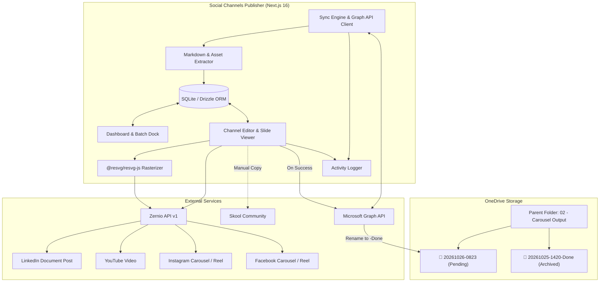

# Social Channels Publisher

An enterprise-grade, full-stack Next.js web application for scheduling, editing, and publishing multi-platform social media content directly from **Microsoft OneDrive** to **LinkedIn**, **YouTube**, **Instagram**, **Facebook**, and **Skool** via the unified **Zernio API**.

---

## 🌟 Key Features

- **OneDrive as the Single Source of Truth**: Continuously monitors a designated OneDrive parent folder for newly generated content packages.
- **Automated `-Done` Lifecycle**:
  - Folders without the `-Done` suffix (e.g., `20261026-0823`) are flagged as **Unpublished / Pending**.
  - Folders with the `-Done` suffix (e.g., `20261026-0823-Done`) are archived as **Published**.
  - Upon publishing across all target channels (or via 1-click **"Mark Done & Rename"**), the app automatically renames the folder on OneDrive via Microsoft Graph API.
- **Smart Folder Skip Filtering**:
  - Automatically skips folders that do not start with a digit (`0-9`).
  - Automatically skips folders ending with `"Skip"` or `"Skipped"` (case-insensitive).
- **On-the-Fly SVG-to-PNG Rasterization**:
  - Carousel slide graphics stored as `.svg` vectors are rendered in-memory to ultra-crisp PNG buffers using native `@resvg/resvg-js` before upload to Instagram and Facebook Graph APIs.
  - Native `.pdf` files are uploaded directly to LinkedIn for document carousel posts without rasterization.
- **Multi-Channel Content Editor**:
  - Dedicated tabs for **LinkedIn**, **YouTube**, **Instagram**, **Facebook**, and **Skool**.
  - Interactive slide carousel viewer with thumbnail bar and natural numeric slide ordering (`slide-1` to `slide-16`).
  - Integrated HTML5 video player for `*-hyperframes.mp4` assets.
  - Character counter with platform-specific limit warnings.
  - One-click copy buttons for Skool community text.
- **Multi-Account Zernio Integration**:
  - Store multiple Zernio API accounts with AES-256-GCM encryption at rest.
  - Live API key connection testing and social profile discovery with avatars.
  - Route individual channel posts to specific connected social accounts.
- **Batch Multi-Select & Actions**:
  - Multi-select folders on the dashboard with a floating action dock.
  - Batch "Mark Done & Rename on OneDrive" and "Batch Publish" operations.
- **Audit Trail & Activity Log (`/activity`)**:
  - Real-time audit trail capturing syncs, publishes, renames, and errors.
  - Filter by event type and inspect raw metadata payloads.
- **Mobile-First Responsive SaaS UI**:
  - Dark-mode SaaS aesthetics with zero "AI-slop".
  - Bottom navigation bar on mobile with 44px minimum tap targets.
  - Collapsible desktop sidebar with live status indicators.

---

## 🏗️ Architecture & Flow



---

## 📁 Content Folder Convention

Each subfolder inside your OneDrive parent folder represents a complete social media campaign:

```
📁 20261026-0823/                          ← Unpublished (no "-Done" suffix)
├── 📄 linkedin-post.md                   ← Title + Body for LinkedIn personal & page
├── 📄 facebook-post.md                   ← Conversational Facebook post text
├── 📄 youtube.md                         ← Title options + SEO video description & tags
├── 📄 instagram-post.md                  ← Instagram caption + hashtags
├── 📄 twitter-post.md                    ← Single tweet (<280) + full thread variant
├── 📄 skool-post.md                      ← Title + Body for Skool community
├── 📄 caption.md                         ← Fallback caption for legacy folders
├── 📄 cover-prompt.md                    ← Prompt reference metadata
├── 🖼️ cover.svg                          ← Cover artwork & dashboard thumbnail
├── 🎬 code-moats-hyperframes.mp4         ← YouTube video / Instagram Reel / Facebook Reel
├── 🎬 code-moats.mp4                     ← Standard video export
├── 📑 code-moats.pdf                     ← LinkedIn native document carousel
└── 📁 slides/                            ← Individual slide vectors
    ├── 🖼️ code-moats-slide-1.svg
    ├── 🖼️ code-moats-slide-2.svg
    └── 🖼️ code-moats-slide-16.svg
```

### Channel Asset Mapping

| Channel | Text Source | Primary Asset | Post Format |
|---|---|---|---|
| **LinkedIn** | `linkedin-post.md` (or `caption.md`) | `*.pdf` | Document Carousel |
| **LinkedIn Page**| `linkedin-post.md` (mirrors LinkedIn) | `*.pdf` | Document Carousel |
| **YouTube** | `youtube.md` (or `caption.md`) | `*-hyperframes.mp4` / `*.mp4` | Video Upload |
| **Instagram** | `instagram-post.md` (or `caption.md`) | `slides/*.svg` (rasterized to PNG) **OR** `*.mp4` | Multi-image Carousel **OR** Reel |
| **Facebook** | `facebook-post.md` (or `caption.md`) | `slides/*.svg` (rasterized to PNG) **OR** `*.mp4` | Multi-image Carousel **OR** Reel |
| **Threads / X** | `twitter-post.md` (or `caption.md`) | `*-hyperframes.mp4` **OR** `slides/*.svg` **OR** `cover.svg` | Video / Carousel / Feed |
| **Skool** | `skool-post.md` (or `caption.md`) | `cover.svg` | Manual Copy-Paste |

---

## 🚀 Getting Started

### Prerequisites

- **Node.js**: `v20.x` or `v22.x`
- **Microsoft Azure Account**: For OneDrive OAuth 2.0 delegated access
- **Zernio API Account**: For multi-platform publishing

---

### Step 1: Azure App Registration Setup

1. Sign in to the [Azure Portal](https://portal.azure.com/).
2. Navigate to **Microsoft Entra ID** > **App registrations** > **New registration**.
3. Fill in:
   - **Name**: `Social Channels Publisher`
   - **Supported account types**: *Accounts in any organizational directory and personal Microsoft accounts* (or *Single tenant* if enterprise-only).
   - **Redirect URI**: Select **Web** and enter:
     ```
     http://localhost:3000/api/onedrive/callback
     ```
     *(For production, replace with your live domain e.g., `https://your-domain.com/api/onedrive/callback`)*
4. Click **Register**.
5. Copy the **Application (client) ID** and save it.
6. Under **Certificates & secrets** > **Client secrets**, click **New client secret**. Copy the secret **Value**.
7. Under **API permissions** > **Add a permission** > **Microsoft Graph** > **Delegated permissions**, add:
   - `Files.ReadWrite` (read and rename OneDrive folders)
   - `User.Read` (view profile info)
   - `offline_access` (refresh token maintenance)
8. Click **Grant admin consent** if applicable.

---

### Step 2: Environment Configuration

Create a `.env.local` file in the project root:

```env
# Application Secrets
ADMIN_PASSWORD=your_secure_admin_password
SESSION_SECRET=a_random_32_character_string_for_session_encryption
DATABASE_URL=file:./data/social-publisher.db

# Microsoft Graph API (OneDrive)
AZURE_CLIENT_ID=your_azure_client_id
AZURE_CLIENT_SECRET=your_azure_client_secret
AZURE_TENANT_ID=common
AZURE_REDIRECT_URI=http://localhost:3000/api/onedrive/callback

# Data Encryption (AES-256-GCM key for encrypted Zernio API keys)
ENCRYPTION_KEY=64_character_hex_string_representing_32_bytes
```

> **Tip**: You can generate a random 32-byte hex encryption key in terminal:
> ```bash
> node -e "console.log(require('crypto').randomBytes(32).toString('hex'))"
> ```

---

### Step 3: Local Development

```bash
# Install dependencies
npm install

# Run database migrations
npm run db:push

# Start development server
npm run dev
```

Open [http://localhost:3000](http://localhost:3000) in your browser:
1. Log in using your configured `ADMIN_PASSWORD`.
2. Navigate to **OneDrive Source** (`/settings/onedrive`) and click **Connect Microsoft OneDrive**.
3. Select your parent folder (e.g., `02 - Carousel Generation Output`).
4. Navigate to **Zernio Accounts** (`/settings/zernio`) and add your Zernio API key.
5. Click **Sync from OneDrive** on the dashboard to pull all pending content packages!


---

## 🛠️ Tech Stack Details

| Technology | Purpose |
|---|---|
| **Next.js 16** (App Router) | Core framework with Turbopack, React Server Components, and Partial Prerendering |
| **TypeScript** | Strict type safety across API routes and client interfaces |
| **Tailwind CSS v4** | Clean, fast, modern SaaS design system |
| **SQLite + Drizzle ORM** | Portable, zero-maintenance local relational database |
| **@resvg/resvg-js** | High-performance native SVG to PNG rasterizer |
| **Microsoft Graph SDK** | Delegated OAuth 2.0 client for OneDrive content & folder renames |
| **Zernio REST API** | Multi-platform publishing engine for LinkedIn, YouTube, Instagram, and Facebook |
| **TanStack React Query** | Optimistic UI, background caching, and automatic refetching |

---

## 📜 License

MIT License. Built for creators and social media teams managing high-volume, multi-channel publishing pipelines.